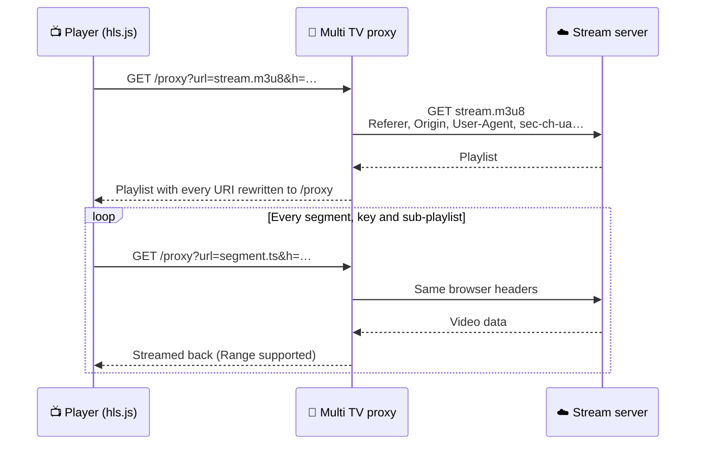

<div align="center">

# 📺 Multi TV

### Your own multi-screen live TV wall: YouTube live streams and M3U8 (HLS) streams, side by side.

[](https://erdinckaya97.github.io/multi-tv/)


[Features](#-features) ·
[Quick start](#-quick-start) ·
[M3U8 streams](#-m3u8-streams) ·
[How the proxy works](#-how-the-proxy-works) ·
[Development](#%EF%B8%8F-development) ·
[FAQ](#-faq)

</div>

---

## ✨ Features

<table>
<tr>
<td width="50%" valign="top">

### 📡 Always live
Each default channel plays its live video and keeps the channel ID as a backup: if the video ends or becomes unavailable, the screen automatically switches to the channel's *current* broadcast. You can also add any channel by its channel ID to always follow its live stream.

### 🎞️ M3U8 / HLS support
Paste any `.m3u8` link and it plays right next to your YouTube channels, powered by [hls.js](https://github.com/video-dev/hls.js), with automatic recovery from network hiccups.

### 🕵️ Browser impersonation
Streams that only play on their own website? Set a **Referer** (filled in automatically) and pick a **browser identity** (Chrome, Safari, Firefox, iPhone, Android or custom), and the built-in proxy requests the stream exactly like that browser would.

</td>
<td width="50%" valign="top">

### 🧩 Smart grid
The layout picks the arrangement that shows every 16:9 screen as large as possible and adapts to any display, from phones to ultrawide monitors.

### 🔊 One sound at a time
Unmuting a screen mutes the others instantly, without reloading the stream.

### 💾 Zero setup
No build step and no dependencies. Your channels, language and preferences are saved in the browser.

### 🌐 Türkçe & English
Switch the interface language anytime from Settings or the player's top bar. On the first visit it follows your browser's language.

</td>
</tr>
</table>

### 🇹🇷 Ready-made news wall

Out of the box you get six Turkish news channels:

| A Haber | Habertürk | Sözcü TV | CNN Türk | tv100 | Haber Global |
|:---:|:---:|:---:|:---:|:---:|:---:|

## 🚀 Quick start

**Just YouTube?** Open the [live demo](https://erdinckaya97.github.io/multi-tv/). That's it.

**Want M3U8 streams with Referer and browser identity?** Run it locally (Node.js 18+, nothing to install):

```bash
git clone https://github.com/erdinckaya97/multi-tv.git
cd multi-tv
npm start
```

Then open **http://127.0.0.1:8080**.

### Controls

| Action | How |
|---|---|
| *Settings*, *Fullscreen* and the **TR · EN** language switch | Always in the top bar. In fullscreen the bar hides; move the mouse to the **top edge** to bring it back. |
| Unmute, fullscreen or remove a screen | Hover over the screen |
| Add, rename or remove channels | **Settings** |

## 📼 M3U8 streams

Add a channel and paste a stream URL into the source field. As soon as an `.m3u8` link is detected, extra options appear:

| Option | What it does |
|---|---|
| **Referer** | Filled in automatically from the stream's address (e.g. `https://cdn.example.com/`). Change it to the website that normally plays the stream. Click **Auto** to restore the automatic value. |
| **Browser identity** | Which browser the request pretends to come from: Chrome (Windows / macOS / Android), Safari (macOS / iPhone), Firefox or a custom User-Agent. |
| **Play through proxy** | On by default. Sends the stream through the built-in proxy so the Referer and browser identity are applied, and works around CORS and mixed-content errors. |

The **Proxy** section in Settings shows whether the proxy is reachable. If you host the proxy somewhere else, enter its address there.

### Supported sources

| Input | Plays |
|---|---|
| `UCV6zcRug6Hqp1UX_FdyUeBg` | The YouTube channel's current live stream |
| `https://www.youtube.com/channel/UC…` | The YouTube channel's current live stream |
| `https://www.youtube.com/watch?v=…`, `youtu.be/…`, `/live/…` | That specific YouTube video |
| `https://example.com/live/stream.m3u8?token=…` | The HLS stream |

> [!TIP]
> For YouTube TV channels, prefer the channel ID: a live video's ID changes whenever the broadcast restarts, while the channel ID never does. You can find it on the channel page under **About → Share channel → Copy channel ID**.

## 🔀 How the proxy works

Browsers don't let web pages change the `Referer` or `User-Agent` headers. That's why Multi TV ships with a small proxy (`server.js`) built on plain Node.js:



- **Every request** in the stream (variant playlists, segments, encryption keys, init segments, audio tracks) goes through the proxy with the same headers.
- **Browser-accurate headers:** `User-Agent`, `Referer`, matching `Origin`, `Accept-Language`, `Sec-Fetch-*` and, for Chrome identities, `sec-ch-ua` client hints.
- **Safe defaults:** the server only listens on `127.0.0.1`, serves only the app's own files and refuses to proxy localhost or private network addresses.

| Environment variable | Default | Description |
|---|---|---|
| `PORT` | `8080` | Port to listen on |
| `HOST` | `127.0.0.1` | Interface to bind. Use `0.0.0.0` to reach it from other devices on your network. |
| `ALLOW_PRIVATE` | — | Set to `1` to allow streams hosted on localhost or your local network |

```bash
HOST=0.0.0.0 PORT=3000 npm start
```

## 🛠️ Development

```bash
npm start   # app + proxy on http://127.0.0.1:8080
npm test    # unit and integration tests (node:test)
```

```
multi-tv/
├── index.html              # Markup
├── style.css               # Styles
├── lib.js                  # Shared logic: source parsing, embed and proxy URLs, playlist
│                           # rewriting, browser headers, grid layout, settings, translations
├── script.js               # UI and players (YouTube iframe + hls.js)
├── server.js               # Static server and M3U8 proxy, no dependencies
└── tests/
    ├── lib.test.js         # Unit tests
    └── server.test.js      # Proxy tests against a fake Referer-protected stream server
```

## ❓ FAQ

<details>
<summary><b>An M3U8 stream shows "Stream could not be loaded".</b></summary>

The error shows the HTTP status code. `403` usually means the server expects a different **Referer**: set it to the page where the stream normally plays and try another **browser identity**. Also make sure the proxy status in Settings is green. Streams that require cookies or DRM can't be played.
</details>

<details>
<summary><b>M3U8 streams work locally but not on GitHub Pages.</b></summary>

GitHub Pages can only host static files, so the proxy isn't available there. Streams then play directly from the browser, without a custom Referer or browser identity, and only if the stream server allows it (CORS, HTTPS). Run `npm start` locally, or host `server.js` on any Node.js host and enter its address in the **Proxy** setting.
</details>

<details>
<summary><b>A YouTube channel stays black.</b></summary>

The channel is either not live at the moment or doesn't allow its stream to be embedded on other sites. Opening `index.html` directly from disk (`file://`) also doesn't work, because YouTube refuses embeds without an origin.
</details>

<details>
<summary><b>Why does everything start muted?</b></summary>

Browsers only allow autoplay with the sound off. Hover over a screen and click **Unmute**.
</details>

> [!IMPORTANT]
> Multi TV is not affiliated with YouTube or any broadcaster. Only add streams you have the right to watch.
